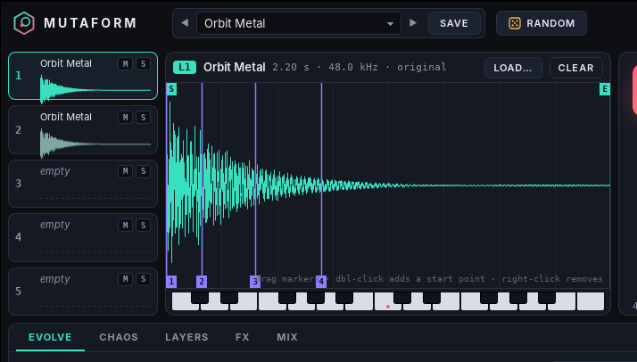

# MUTAFORM

**MUTAFORM** is a VST3 / Standalone instrument for Windows that turns a short one-shot
sample into a playable, multi-layer instrument — and lets you **EVOLVE** it into new
variations, endlessly. No AI: every variation is an algorithmic, seeded chain of DSP
processes, so any result can be reproduced from its seed.



*(Interface rendered from the Linux dev build; Windows uses the same embedded web UI.)*

## Install (Windows 10/11, x64)

1. Download the latest `Mutaform-win64` artifact from GitHub Actions
   (*Actions → Build → latest green run → Artifacts*). It unpacks to:
   ```
   Mutaform.vst3/   ← the plugin bundle (a folder)
   Mutaform.exe     ← standalone app
   ```
2. Copy the whole **`Mutaform.vst3`** folder to
   `C:\Program Files\Common Files\VST3\`.
3. Rescan plugins in your DAW. MUTAFORM appears as an **instrument** (Instrument|Sampler).

The UI uses the Microsoft **WebView2 Runtime**, which ships with Windows 10 (21H2+) and 11.
If the window stays blank, install the *Evergreen WebView2 Runtime* from Microsoft.
The WebView2 loader is linked statically; no extra DLL is needed next to the plugin.

## Quick start

1. Drag a WAV / AIFF / FLAC / MP3 one-shot onto the big drop zone (or onto a layer slot on
   the left; dropping several files fills consecutive layers). **LOAD…** opens a file chooser.
2. Play MIDI — the sample's original pitch sits on **C3 (MIDI 60)**. In the Standalone you can
   also play the on-screen keys or your computer keyboard (`A W S E D F T G Y H U J K …`,
   `Z`/`X` = octave, `Space` = EVOLVE).
3. Press **EVOLVE**. A new variation is rendered in the background and replaces the layer's
   sound. Press again for another one, forever. **UNDO / REDO** walk the history
   (32 steps per layer); the **EVOLVE** tab shows every variation with its seed — click one
   to jump back, or type a seed and press **RENDER SEED** to reproduce a result.
4. Turn **CHAOS** up for longer, wilder chains; restrict the process pool in the **CHAOS** tab.

## Features (v1.0)

- **5 layers**, each with drag & drop loading, start/end, **LOOP** (loop in/out + equal-power
  crossfade), **REVERSE**, **MULTIPOINT** start points (up to 8; chosen by key, velocity or
  cycling), mute, solo, level, pan, pitch (semitones + cents). Markers are draggable on the
  waveform; double-click adds a start point, right-click removes it.
- **Sampler**: 16-voice polyphony, click-free voice stealing, amp ADSR, velocity sensitivity,
  sustain pedal, pitch bend ±2 st, cubic (Hermite) resampling with sample-rate conversion.
- **EVOLVE**: random chain of 2–5 processes out of 8 — pitch shift, granular shuffle,
  envelope-swept resonant filter, saturation/waveshaping (tanh/fold/asym/bit-crush),
  time-stretch, ring modulation, reverse reverb swell, transient shaping. Rendered offline on
  a worker thread, normalised to −1 dBFS. 64-bit seed per variation, fully deterministic.
- **CHAOS** 0–100 %: controls chain length (0 % → 2 processes, 100 % → 5) and strength.
- **FX**: filter (LP/HP/BP + resonance), drive, chorus, delay (free or synced to the DAW tempo),
  reverb — each with on/off and mix (smoothed, no clicks).
- **MIX**: layer faders with mute/solo, master level, output peak limiter with ceiling and
  gain-reduction meter.
- **RANDOM**: musical randomisation of layer, envelope, CHAOS and FX parameters.
- **Presets**: JSON + audio in `%APPDATA%\Mutaform\Presets\<name>\`; 5 factory presets
  whose sounds are synthesised in code (*Glass Bloom, Rust Kick, Tape Choir, Seed Pluck,
  Orbit Metal*).
- **Full recall**: the DAW project stores parameters, samples (lossless), multipoints and the
  EVOLVE history (as seeds; intermediate steps are re-rendered on demand).
- Resizable dark UI (600×400 … 1800×1200).

## Build locally

Requirements: Windows 10/11 x64, **Visual Studio 2022** (Desktop C++ workload), CMake ≥ 3.22,
Git, internet access on first configure (JUCE 8, Catch2 and the WebView2 SDK are fetched by
CMake `FetchContent`).

```bat
cmake -B build -G "Visual Studio 17 2022" -A x64
cmake --build build --config Release --parallel
build\Release\MutaformTests.exe
```

Outputs:
- `build\Mutaform_artefacts\Release\VST3\Mutaform.vst3`
- `build\Mutaform_artefacts\Release\Standalone\Mutaform.exe`

With only Visual Studio 2026 installed, use `-G "Visual Studio 18 2026" -A x64 -T v143`
(that is what CI does on current `windows-latest` images).

Validate with [pluginval](https://github.com/Tracktion/pluginval):
```bat
pluginval.exe --strictness-level 10 --validate-in-process --validate build\Mutaform_artefacts\Release\VST3\Mutaform.vst3
```

Linux (development only; needs `libwebkit2gtk-4.1-dev libgtk-3-dev libasound2-dev
libcurl4-openssl-dev`): `cmake -B build -G Ninja -DCMAKE_BUILD_TYPE=Release && cmake --build build`.

CI (`.github/workflows/build.yml`, `windows-latest`): builds Release VST3 + Standalone, runs the
Catch2 tests and pluginval (strictness 10), and uploads the `Mutaform-win64` artifact.

## Project layout

See [CLAUDE.md](CLAUDE.md) for the code map and the strict real-time rules,
[docs/DESIGN.md](docs/DESIGN.md) for the visual concept, [docs/DECISIONS.md](docs/DECISIONS.md)
for design decisions and [docs/PLAN.md](docs/PLAN.md) for the development stages.

## Known limitations

- Windows x64 VST3 + Standalone only (no AU/AAX/CLAP, no macOS build); binaries are not
  code-signed, so SmartScreen may warn about `Mutaform.exe`.
- Requires the WebView2 Runtime (present on up-to-date Windows 10/11).
- Samples are limited to 30 s, EVOLVE output to 20 s; one EVOLVE job runs at a time
  (EVOLVE ALL renders layers one after another).
- All variations of the session's history are kept in RAM (≤ 32 per layer); very long samples
  with full histories can use several hundred MB.
- Upward transpositions of more than ~2 octaves may alias (cubic interpolation, no
  band-limiting).
- Replacing a layer's sound while notes are held continues those notes at the same position
  in the new sound (with a short fade-in) rather than restarting them.
- Presets store each layer's current sound but not its EVOLVE history (the DAW project does).
- Pitch-bend range is fixed at ±2 semitones; no MPE.
- The plugin UI drop target is the WebView; dropping from some hosts' own browsers (which
  don't provide real files) is not supported — use LOAD… instead.

## License / credits

Code, UI, graphics, texts and factory sounds are original to this project. Built with
[JUCE 8](https://juce.com) (AGPLv3 / commercial license) and [Catch2](https://github.com/catchorg/Catch2).
