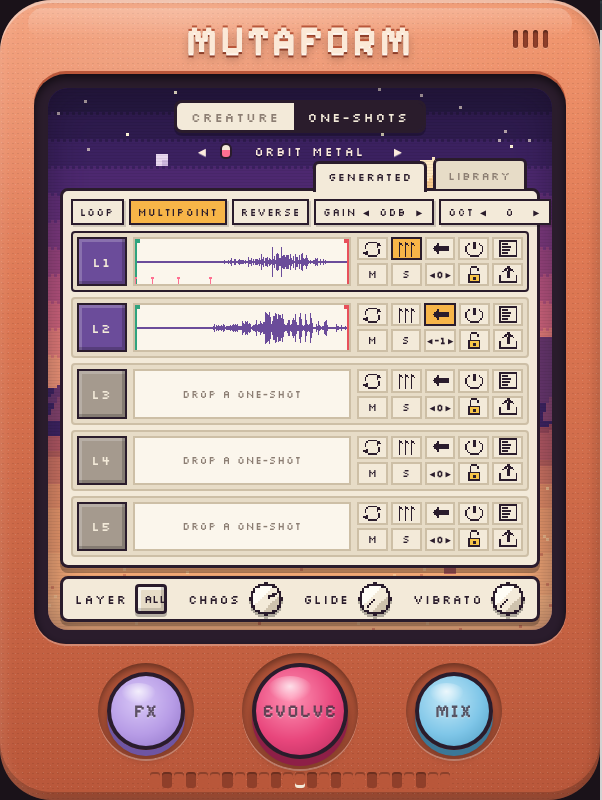

# MUTAFORM

**MUTAFORM** is a VST3 / Standalone instrument for Windows that turns a short one-shot
sample into a playable, multi-layer instrument — and lets you **EVOLVE** it into new
variations, endlessly. No AI: every variation is an algorithmic, seeded chain of DSP
processes, so any result can be reproduced from its seed.

<p> </p>

*(Rendered from the Linux dev build; Windows uses the same embedded web UI.)*

## Install (Windows 10/11, x64)

1. Download the latest `Mutaform-win64` artifact from GitHub Actions
   (*Actions → Build → latest green run → Artifacts*). It unpacks to:
   ```
   Mutaform.vst3/   ← the plugin bundle (a folder)
   Mutaform.exe     ← standalone app
   ```
2. Copy the whole **`Mutaform.vst3`** folder to
   `C:\Program Files\Common Files\VST3\`.
3. Rescan plugins in your DAW. MUTAFORM appears as an **instrument** (Instrument|Sampler).

The UI uses the Microsoft **WebView2 Runtime**, which ships with Windows 10 (21H2+) and 11.
If the window stays blank, install the *Evergreen WebView2 Runtime* from Microsoft.
The WebView2 loader is linked statically; no extra DLL is needed next to the plugin.

## Quick start

1. Drop a WAV / AIFF / FLAC / MP3 one-shot onto the screen (or click the little spore to browse).
   On the **ONE-SHOTS** page you can drop onto a specific layer row (5 layers).
2. Play MIDI — original pitch on **C3 (MIDI 60)**. The tiny keys under the buttons, or your
   computer keyboard (`A W S E D F T G Y H U J K …`, `Z`/`X` octave), audition the sound;
   `Space` = EVOLVE.
3. Press the big **EVOLVE** button. Your sound mutates (rendered in the background) and the
   creature grows: SPORE → SPROUT → CUB → SCAMP → YOUTH → ADULT → ELDER → ANCIENT.
   The **LAYER** box picks what mutates (ALL or one layer); **CHAOS** sets how wild it gets.
4. **◀ ▶** on the level bar walk back and forth through your mutations; the **star** marks a
   favourite, the **lock** protects layers from mutating.
5. The **dice** rolls a random sound (parameters + mutations); the arrow next to it undoes the roll.
6. **FX** and **MIX** buttons open the effects and mixer panels.

## Features (v1.1)

- **Creature view**: pixel-art mascot whose stage follows your mutation level and whose look
  follows the sound (bright/dark colours, spikes for plucky sounds, wobble for moving sounds).
  CHAOS, GLIDE and VIBRATO knobs, level navigation, favourite, lock, presets, save, dice.
- **ONE-SHOTS → GENERATED**: 5 layers with waveform and draggable start/end/loop/multipoint
  markers; per layer LOOP (with crossfade), MULTIPOINT (key / velocity / cycle), REVERSE,
  back-to-original, library, MUTE, SOLO, octave, LOCK, export to WAV; toolbar GAIN/OCT.
- **ONE-SHOTS → LIBRARY**: every variation of a layer with a generated name and automatic tags
  (DARK, BRIGHT, PLUCKY, SMOOTH, MOVING, STEADY), favourites, RANDOM pick.
- **Sampler**: 16 voices, amp ADSR, velocity, glide, vibrato, sustain pedal, pitch bend ±2 st,
  cubic (Hermite) resampling, per-layer level/pan/semitones/cents.
- **EVOLVE**: random chain of 2–5 out of 8 processes — pitch shift, granular shuffle,
  envelope-swept filter, saturation/waveshaping, time-stretch, ring mod, reverse reverb swell,
  transient shaping — rendered offline on a worker thread, normalised, 64-bit seed per
  variation (fully reproducible). The process pool can be restricted in the FX panel.
- **FX**: filter LP/HP/BP + resonance, drive, chorus, delay (free or DAW-synced), reverb —
  each with on/off + mix. **MIX**: layer faders, pan, fine tune, mute/solo, amp envelope,
  master, output limiter with gain-reduction meter, loop/region knobs for the selected layer.
- **Presets**: JSON + audio in `%APPDATA%\Mutaform\Presets\<name>\`; 5 factory presets with
  sounds synthesised in code (*Glass Bloom, Rust Kick, Tape Choir, Seed Pluck, Orbit Metal*).
- **Full recall** in the DAW project: parameters, samples (lossless), multipoints, EVOLVE
  history, favourites, locks.
- Resizable window (3:4, 450×600 … 1200×1600).

## Build locally

Requirements: Windows 10/11 x64, **Visual Studio 2022** (Desktop C++ workload), CMake ≥ 3.22,
Git, internet access on first configure (JUCE 8, Catch2 and the WebView2 SDK are fetched by
CMake `FetchContent`).

```bat
cmake -B build -G "Visual Studio 17 2022" -A x64
cmake --build build --config Release --parallel
build\Release\MutaformTests.exe
```

Outputs:
- `build\Mutaform_artefacts\Release\VST3\Mutaform.vst3`
- `build\Mutaform_artefacts\Release\Standalone\Mutaform.exe`

With only Visual Studio 2026 installed, use `-G "Visual Studio 18 2026" -A x64 -T v143`
(that is what CI does on current `windows-latest` images).

Validate with [pluginval](https://github.com/Tracktion/pluginval):
```bat
pluginval.exe --strictness-level 10 --validate-in-process --validate build\Mutaform_artefacts\Release\VST3\Mutaform.vst3
```

Linux (development only; needs `libwebkit2gtk-4.1-dev libgtk-3-dev libasound2-dev
libcurl4-openssl-dev`): `cmake -B build -G Ninja -DCMAKE_BUILD_TYPE=Release && cmake --build build`.

CI (`.github/workflows/build.yml`, `windows-latest`): builds Release VST3 + Standalone, runs the
Catch2 tests and pluginval (strictness 10), and uploads the `Mutaform-win64` artifact.

## Project layout

See [CLAUDE.md](CLAUDE.md) for the code map and the strict real-time rules,
[docs/DESIGN.md](docs/DESIGN.md) for the visual concept, [docs/DECISIONS.md](docs/DECISIONS.md)
for design decisions and [docs/PLAN.md](docs/PLAN.md) for the development stages.

## Known limitations

- Windows x64 VST3 + Standalone only (no AU/AAX/CLAP, no macOS build); binaries are not
  code-signed, so SmartScreen may warn about `Mutaform.exe`.
- Requires the WebView2 Runtime (present on up-to-date Windows 10/11).
- Samples are limited to 30 s, EVOLVE output to 20 s; one EVOLVE job runs at a time
  (EVOLVE ALL renders layers one after another).
- All variations of the session's history are kept in RAM (≤ 32 per layer); very long samples
  with full histories can use several hundred MB.
- Upward transpositions of more than ~2 octaves may alias (cubic interpolation, no
  band-limiting).
- Replacing a layer's sound while notes are held continues those notes at the same position
  in the new sound (with a short fade-in) rather than restarting them.
- Presets store each layer's current sound but not its EVOLVE history (the DAW project does).
- Pitch-bend range is fixed at ±2 semitones; no MPE. Glide is polyphonic (each new note
  slides from the previously played note).
- Level navigation (◀ ▶) is reset when the project is reloaded; per-layer history is kept.
- The plugin UI drop target is the WebView; dropping from some hosts' own browsers (which
  don't provide real files) is not supported — use LOAD… instead.

## License / credits

Code, UI, graphics, texts and factory sounds are original to this project.
Fonts: Pixelify Sans and Silkscreen (SIL Open Font License 1.1, see `ui/fonts/`). Built with
[JUCE 8](https://juce.com) (AGPLv3 / commercial license) and [Catch2](https://github.com/catchorg/Catch2).
